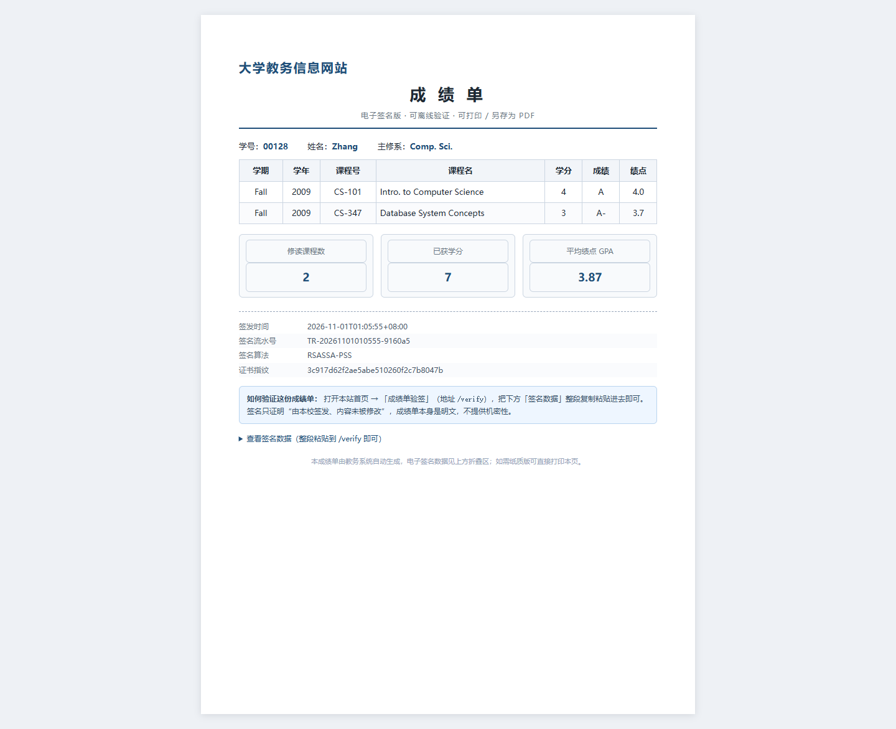
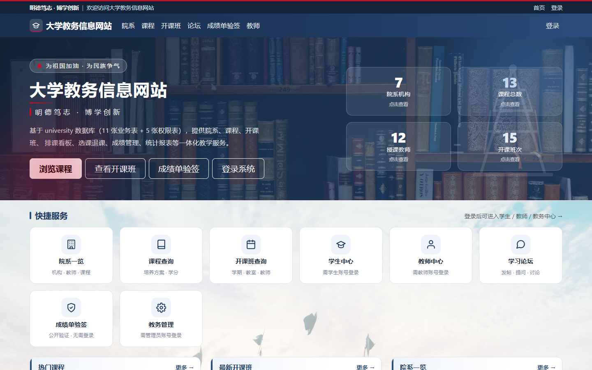

# 成绩单签名 + 公开验证：实现说明

> 方案来源：[数字签名-在university项目里怎么用.md](<docs/数字签名-在university项目里怎么用.md>)（首选方案）
> 自检脚本：`scripts/run-transcript-signing-check.ps1`
> 证据：`docs/transcript-signing-check.txt`（JUnit 9 例 + 真实密钥库冒烟）、
> `docs/transcript-signing-db-check.txt`（MySQL 建表/唯一键）、`docs/transcript-signing-http-check.txt`（Spring Boot 集成）
>
> 状态：**已实现并通过三重验证**（离线单测、真实 PKCS12 冒烟、真实 Spring Boot + MySQL/Redis 集成）。

---

## 1. 实现了什么

一条完整的"学生下载 → 转发 → 任何人验证"链路：

```text
学生（登录）                        服务端                              验证方（用人单位）
  │ 成绩单页点「下载签名版」            │                                    │
  │ ────────────────────────────────> │ GET /student/transcript/signed     │
  │                                   │ 1. StudentService.transcript()     │
  │                                   │ 2. 规范化 JSON + 流水号 + 时间戳     │
  │                                   │ 3. SHA-256 + 私钥签名（RSA-PSS）    │
  │                                   │ 4. 落库 transcript_signature       │
  │ <──────────────────────────────── │ 返回 transcript-<学号>-signed.json  │
  │  转发文件 ──────────────────────────────────────────────────────────> │
  │                                   │ 打开 /verify，粘贴 payload+signature │
  │                                   │ <────────────────────────────────── │
  │                                   │ 用学校公钥验签 → 通过/不通过          │
```

要点：
- 验证端**不需要登录、不需要访问数据库**，只需要"内容 + 签名 + 学校公钥"；
- 签名**不加密**：成绩单仍是明文 JSON，签名只证明"谁发的、有没有被改"；
- 签名覆盖用途（`type=TRANSCRIPT`）、学号/学期/每门课、汇总、签发时间、流水号。

---

## 2. 文件清单

### 新增

| 文件 | 作用 |
|---|---|
| `src/main/resources/db/migration/V13__transcript_signature.sql` | `transcript_signature` 表（只增不改，唯一流水号） |
| `src/main/java/com/ds/university/entity/TranscriptSignature.java` | 实体 |
| `src/main/java/com/ds/university/mapper/TranscriptSignatureMapper.java` | Mapper 接口 |
| `src/main/resources/mapper/university/TranscriptSignatureMapper.xml` | insert / selectBySerialNo |
| `src/main/java/com/ds/university/sign/TranscriptSigningProperties.java` | `app.transcript-signing.*` 配置 |
| `src/main/java/com/ds/university/sign/TranscriptCanonicalizer.java` | 规范化 JSON（字段顺序固定、行排序、数字去尾零、JSON 转义） |
| `src/main/java/com/ds/university/sign/TranscriptSigner.java` | 加载 PKCS12 私钥；RSA-PSS / SHA256withRSA 自动回退；签/验 |
| `src/main/java/com/ds/university/service/TranscriptSignatureService.java` | 组装内容 → 签名 → 落库；验签；参数与长度校验 |
| `src/main/java/com/ds/university/vo/SignedTranscriptVO.java` | 返回给前端的"内容 + 签名 + 公钥/证书指纹" |
| `src/main/java/com/ds/university/controller/TranscriptSignatureController.java` | `GET /student/transcript/signed`（下载 JSON） |
| `src/main/java/com/ds/university/controller/TranscriptVerifyController.java` | `GET|POST /verify`（公开验签页） |
| `src/main/resources/templates/verify.html` | 验签页面（粘贴 + 结果 + 算法/指纹） |
| `scripts/gen-transcript-signing-keystore.ps1` | 生成签名专用证书（KU=digitalSignature） |
| `scripts/run-transcript-signing-check.ps1` | 离线自检：编译 + JUnit + 真实密钥库冒烟 |
| `src/test/java/com/ds/university/sign/TranscriptSignatureServiceTest.java` | 9 个用例 |

### 修改

| 文件 | 改动 |
|---|---|
| `src/main/java/com/ds/university/config/WebMvcConfig.java` | 登录拦截器白名单加 `/verify`（公开验证页） |
| `src/main/resources/application.yml` | 新增 `app.transcript-signing.*` 配置 |
| `src/main/resources/templates/student/transcript.html` | 成绩单页加「下载签名版」按钮 |

---

## 3. 数据模型

```sql
CREATE TABLE IF NOT EXISTS transcript_signature (
    id           BIGINT       NOT NULL AUTO_INCREMENT,
    student_id   VARCHAR(20)  NOT NULL,
    term         VARCHAR(20)  NULL      COMMENT '单学期记学期，多学期记 ALL',
    serial_no    VARCHAR(40)  NOT NULL  COMMENT '签名流水号（也在被签内容里，防重放）',
    payload_hash CHAR(64)     NOT NULL  COMMENT 'SHA-256(规范化 JSON)',
    signature    TEXT         NOT NULL  COMMENT 'Base64 签名',
    cert_serial  VARCHAR(64)  NULL      COMMENT '签名证书序列号（换钥后可追溯历史公钥）',
    issued_at    DATETIME     NOT NULL,
    PRIMARY KEY (id),
    UNIQUE KEY uk_transcript_signature_serial (serial_no),
    KEY idx_transcript_signature_student (student_id, issued_at)
) ENGINE = InnoDB COMMENT = '成绩单签名记录（只增不改）';
```

删改记录没有业务接口；如需吊销，另加 `revoked_at` 或吊销列表（见第 8 节）。

---

## 4. 被签内容：规范化 JSON

```json
{"type":"TRANSCRIPT","version":"v1","studentId":"2021001","studentName":"张伟",
 "deptName":"计算机科学与技术",
 "rows":[{"courseId":"CS301","title":"数据库系统","credits":4,"semester":"FALL","year":2026,
          "grade":"B+","gradePoint":3.3}, ...],
 "courseCount":2,"earnedCredits":8,"gpa":3.5,
 "issuedAt":"2026-11-01T00:20:29+08:00","serialNo":"TR-20261101002029-4d397d"}
```

确定性规则（`TranscriptCanonicalizer`）：

| 规则 | 原因 |
|---|---|
| 字段顺序固定 | 同数据必须逐字节相同，否则哈希对不上 |
| 明细按 `(year, semester, courseId)` 排序 | 与 SQL 返回顺序解耦 |
| 数字 `BigDecimal.stripTrailingZeros()` | `4.0` 与 `4.00` 不得产生不同字符串 |
| 字符串最小转义（`"` `\` 控制字符） | 姓名带引号也不能破坏 JSON |
| `null` 显式输出 | 缺字段不能靠"省略"来表达 |

> 生产若已有统一编码规范，可替换为 JCS（JSON Canonicalization Scheme），但必须保持确定性。

---

## 5. 接口

### 5.1 下载签名版（登录）

`GET /student/transcript/signed`

- 鉴权：`AuthInterceptor` + session（学生本人只能签自己的）；
- 响应（默认）：`text/html;charset=UTF-8`，`Content-Disposition: attachment; filename="transcript-00128-signed.html"`，
  即**可打印的成绩单表格**（含汇总与签名信息，文末附完整签名数据）；
- 响应（`?format=json`）：`application/json;charset=UTF-8`，`filename="transcript-00128-signed.json"`，供程序消费；
- JSON 字段（HTML 里的签名数据是同一份 JSON）：

| 字段 | 说明 |
|---|---|
| `payload` | 被签名的规范化 JSON（验证时粘贴这一段） |
| `signature` | Base64 签名 |
| `payloadHash` | SHA-256(payload)，便于人工核对 |
| `serialNo` / `issuedAt` | 流水号 / 签发时间 |
| `algorithm` | `RSASSA-PSS` 或 `SHA256withRSA` |
| `publicKey` | 公钥（X.509 Base64），供第三方独立验证 |
| `certificateFingerprint` | 证书指纹（SHA-256 前 16 字节） |

### 5.2 公开验签

- `GET /verify`：表单页（**免登录**，已加入 AuthInterceptor 白名单）；
- `POST /verify`：`payload` + `signature`（+ CSRF token），返回"通过/不通过"。

安全取舍：
- **只返回布尔结果**，不回显成绩内容——否则验证页就成了免登录的数据接口；
- 保留 CSRF 校验（GET 下发 token，表单带 `_csrf`），公开页也不豁免；
- 失败提示统一为"内容或签名不匹配"，不区分"签名错"与"内容被改"；
- 单次内容上限 20000 字符（`TranscriptSignatureService.MAX_PAYLOAD_CHARS`）。

---

## 6. 配置与密钥

`application.yml`：

```yaml
app:
  transcript-signing:
    enabled: ${TRANSCRIPT_SIGNING_ENABLED:true}
    keystore: ${TRANSCRIPT_SIGNING_KEYSTORE:./keystore/transcript-signing.p12}
    store-password: ${TRANSCRIPT_SIGNING_STORE_PASSWORD:changeit}
    alias: ${TRANSCRIPT_SIGNING_ALIAS:transcript-signer}
    generate-if-missing: ${TRANSCRIPT_SIGNING_GENERATE_IF_MISSING:true}
    key-size: 2048
```

生成签名证书（与 HTTPS 证书分开，专钥专用）：

```powershell
.\scripts\gen-transcript-signing-keystore.ps1
# 输出 keystore\transcript-signing.p12（已 gitignore），别名 transcript-signer
```

行为：
- 密钥库存在 → 加载私钥与证书，打印算法/指纹/序列号；
- 密钥库不存在且 `generate-if-missing=true` → 生成临时 RSA 密钥并 **WARN**（仅开发环境，重启后历史签名失效）；
- 密钥库不存在且 `generate-if-missing=false` → **启动失败**（生产应如此，避免悄悄换钥）。

生产建议：私钥放 KMS/HSM 或加密密钥库，口令走环境变量/密钥管理，不要写进配置文件与仓库。

---

## 7. 验证证据（可复现）

一键自检：

```powershell
pwsh -File scripts\run-transcript-signing-check.ps1
```

输出 `docs/transcript-signing-check.txt`：

```text
=== 3) 编译并运行 JUnit 测试 ===
[ 9 tests found ]  [ 9 tests successful ]  [ 0 tests failed ]

=== 4) 真实 PKCS12 密钥库冒烟 ===
算法: RSASSA-PSS
证书指纹: 3c917d62f2ae5abe510260f2c7b8047b
payload: {"type":"TRANSCRIPT",...}
验签(原内容): true
验签(改 GPA): false
验签(改签名): false
```

MySQL 建表/唯一键验证（`docs/transcript-signing-db-check.txt`）：V13 在独立库执行成功，插入后可查，
重复 `serial_no` 触发 `Duplicate entry ... uk_transcript_signature_serial`（符合预期）。

Spring Boot 集成（`docs/transcript-signing-http-check.txt`，本机 MySQL 8.0.44 + Redis）：

```text
GET  /verify                                   -> 200，页面含"成绩单签名验证"
POST /verify（有效 payload + 签名）             -> 验签通过
POST /verify（GPA 从 3.5 改成 4.0）             -> 验签不通过
GET  /student/transcript/signed（未登录）       -> 302 跳转 /login
Flyway                                         -> 14 个迁移校验通过，schema 版本 13（V13 已应用）
```

另外：`javac --release 8 -parameters -cp target/lib/*` 编译全部 **847** 个主源码文件通过（与 Maven 的
`-parameters` 行为一致），Mapper XML 通过 XML 解析与 Spring 启动加载。

---

## 8. 已知边界与后续可做

| 项 | 现状 | 建议 |
|---|---|---|
| 验证页限流 | 未做 | 用现有 Redis 计数（参考 `LoginRateLimit`）按 IP 限流；异常流量记审计 |
| PDF 签名 | 只签 JSON | 若要签 PDF，把规范化 JSON 作为附件/元数据一起签，或对 PDF 字节签名并记录哈希 |
| 证书链 / 时间戳 | 自签单证书 | 对外流转建议接学校 CA 或 RFC 3161 时间戳，证明"签发时证书有效" |
| 吊销 | 无 | 加 `revoked_at` 或 CRL/OCSP 查询；验证页展示吊销状态 |
| `gradePoint` | `transcript()` 的 SQL 未取绩点，签名里为 `null` | 需要覆盖绩点时，把 `selectTranscript` 的 SQL 补上绩点 join（与 `selectTranscriptPage` 一致） |
| 审计 | 下载/验签未进审计 | 下载写 `AuditService`（ACTION_CREATE, TARGET_GRADE? 或新增 TARGET_TRANSCRIPT_SIGN），验签只记日志 |

---

## 9. 手动试跑

```powershell
# 1) 生成签名证书（一次性）
.\scripts\gen-transcript-signing-keystore.ps1

# 2) 启动应用（dev）
mvn spring-boot:run
# 或已编译：java -cp "target\classes;target\lib\*;src\main\resources" com.ds.university.UniversityApplication

# 3) 浏览器
#    登录学生 -> 学生中心 -> 成绩单 -> 「下载签名版」
#    拿到 transcript-<学号>-signed.json
#    打开 http://localhost:8080/verify，粘贴 payload 与 signature -> 验证
```

---

## 10. 排查记录（实现时踩到的两个坑）

1. **Spring 构造器二义性**：`TranscriptSigner` 同时有 Spring 构造器与测试构造器，Spring 找不到默认构造器 →
   给 Spring 用构造器加 `@Autowired` 解决。
2. **`@RequestParam` 参数名丢失**：用纯 `javac` 编译（不带 `-parameters`）时，Spring 解析不到参数名，
   运行时报 `Name for argument of type [java.lang.String] not specified` → 注解里显式写 `name = "payload"`，
   并在自检脚本里加 `-parameters` 与 Maven 对齐。

---

## 11. 修复记录：验签不通过（2026-11-01）

**现象**：按提示操作后 `/verify` 返回"验签不通过"。

**复现**：下载 `transcript-00128-signed.json` 后，直接把 JSON 文件里 `payload` 字段的**原文**
（内容是 `{\"type\":\"TRANSCRIPT\"...}`，带 JSON 转义）粘到网页，验签必然失败——
签名保护的是"未转义的原始 JSON 字节"，多一层 `\"` 就是另一段字节。

同时发现：整段粘贴 signed JSON 也会失败（页面只认单独的 payload/signature）。

**修复**（`TranscriptVerifyInput` + `TranscriptVerifyController` + `verify.html`）：

1. `/verify` 新增「完整 JSON」输入框：粘贴整个 `transcript-*-signed.json` 即可，后端自动取出
   `payload` 与 `signature`；
2. 若只贴了 `payload` 字段：先按原样验签，失败再尝试 JSON 反转义后验签（只纠正转义，不改变合法内容）；
3. 页面文案改成分步说明，并加「验签不通过？按这个顺序排查」清单
   （转义复制 / 证书指纹是否一致 / 内容是否被改 / 签名是否完整）；
4. 新增 `TranscriptVerifyInputTest`（5 例），自检总数 9 → **14**。

**修复后验证**（`docs/transcript-signing-verify-input-check.txt`）：

```text
① 整段粘贴 signed JSON                         -> 验签通过
② 从 JSON 文件复制带 \" 转义的 payload          -> 自动反转义后验签通过
③ 篡改 studentId                              -> 验签不通过
④ 只贴 payload 不贴签名                        -> 友好提示（没法识别输入）
```

**排查清单**（如果仍然不通过）：
1. 对比下载文件里的 `certificateFingerprint` 与 `/verify` 页底部指纹——不一致说明换过密钥
   （开发环境未生成 `keystore/transcript-signing.p12` 时会用临时密钥，重启即换）；
2. 内容是否被编辑器改过（多一个空格/换行都不行）；
3. 签名是否被截断（Base64 一般 344 字符，结尾可能带 `=`）。
---

## 12. 体验优化：可打印 HTML 成绩单 + 首页验签入口（2026-11-01）

**问题**：下载得到的是裸 JSON 文件，不像"成绩单"；首页也没有验签入口，非技术用户找不到。

**改动**：

1. `GET /student/transcript/signed` 默认返回**可打印的 HTML 成绩单**（`.html` 附件）：
   校名/标题、学号姓名院系、课程明细表格（含绩点）、汇总卡片（课程数/学分/GPA）、
   签发时间/流水号/算法/证书指纹，文末折叠区给出完整签名数据；内置打印样式，浏览器里可直接打印或另存 PDF；
2. `?format=json` 保留原 JSON 输出（程序/自动化用，签名与 HTML 版一致）；
3. `selectTranscript` 补上 `grade_point`：此前表格"绩点"列显示 `-`，签名内容里 `gradePoint` 也是 `null`；
4. 首页：导航栏加「成绩单验签」，主视觉加按钮，快捷服务加"成绩单验签"卡片（公开验证 · 无需登录）；
5. 学生成绩单页按钮改为「下载签名版（可打印）」并加一行提示（发给用人单位 → 对方打开验签页）。

**验证**（`docs/transcript-signed-download-check.txt`）：

```text
GET /student/transcript/signed -> 200, Content-Type=text/html; charset=UTF-8
Content-Disposition -> attachment; filename="transcript-00128-signed.html"
HTML 含表格=True，含签名数据区=True，含绩点列=True，含学号=00128
GET /student/transcript/signed?format=json -> 200，payload 含 gradePoint=True
首页含「成绩单验签」快捷卡=True，导航链接 /verify=True
GET /verify -> 200
把 ?format=json 的整段 JSON 粘贴验签 -> 通过=True
```



